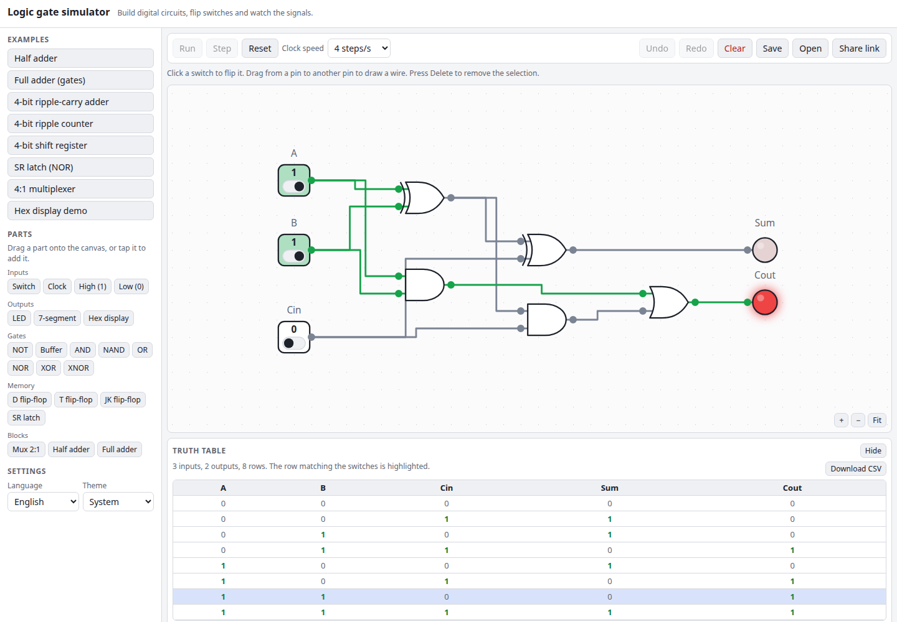

# Logic Gate Simulator

A drag-and-drop digital logic simulator that runs entirely in your browser. Drop gates, flip-flops, multiplexers, adders, clocks, switches, LEDs and 7-segment displays onto the canvas, wire them together, flip the switches and watch the signals change colour. A truth table is generated for any circuit, and a circuit can be saved to a file or shared as a link.

**Try it: [hermes98761234.github.io/logic-gate-simulator](https://hermes98761234.github.io/logic-gate-simulator/)**

[](https://github.com/hermes98761234/logic-gate-simulator/actions/workflows/deploy.yml)



## Features

- **A real parts bin.** Switches, clock, constant 1/0, LEDs, a raw 7-segment display and a hex display (4-bit input), NOT, buffer, AND, NAND, OR, NOR, XOR and XNOR (2 to 4 inputs), D, T and JK flip-flops, an SR latch, a 2:1 multiplexer, and half and full adder blocks.
- **Drag and drop, with routed wires.** Drag a part from the palette (or tap it on a phone), drag from a pin to another pin to wire it up, drag parts to move them on a snap grid. Wires are routed orthogonally and glow green when they carry a 1. Pan, zoom and fit-to-view are built in.
- **Event-driven simulation.** Only parts whose inputs changed are re-evaluated, one unit gate delay per step. Feedback circuits such as latches work, and a circuit that never settles (a ring oscillator, for example) is detected and reported.
- **Truth table generator.** Every combination of the switches is tried and the LEDs are read; the row matching the current switch positions is highlighted, and the table downloads as CSV.
- **Example circuits.** Half adder, full adder from gates, 4-bit ripple-carry adder, 4-bit ripple counter, shift register, NOR SR latch, 4:1 multiplexer and a hex display.
- **Save, load and share.** Download the circuit as JSON, open it again, or copy a link that carries the whole circuit in the URL hash (compressed, nothing is uploaded). Undo and redo cover every edit.
- **English or Ukrainian, light, dark or system theme.** The circuit and settings are remembered in the browser. No backend, no tracking.

## How it works

Each part has a small evaluation function (`src/lib/logic.ts`). The simulator (`src/lib/sim.ts`) compiles the wiring into output slots and fan-out lists. A step evaluates every queued part against the old signal values, applies all results at once, and queues the parts those changes feed. This gives race-free flip-flops: a D flip-flop samples D on the rising clock edge, using the values from before the edge. At power-up, parts are evaluated one at a time so cross-coupled latches start in a defined state.

The simulator is checked against gate truth tables, flip-flop behaviour, a counter that counts 0 to 15 and wraps, a shift register, a NOR latch, and exhaustive tests of the 1-bit and 4-bit adders (all 512 input combinations).

Notes: unconnected inputs read as 0. The SR latch block treats S = R = 1 as forbidden and drives both outputs low. A ripple counter clocks each stage from the previous one, so its bits settle one after another within a clock step.

## Quick start

You need [Node.js](https://nodejs.org/) 22.

```bash
git clone https://github.com/hermes98761234/logic-gate-simulator.git
cd logic-gate-simulator
npm install
npm run dev       # http://localhost:5173
npm test          # simulator, circuit, routing and i18n tests
npm run build     # static site in dist/
```

## License

MIT
